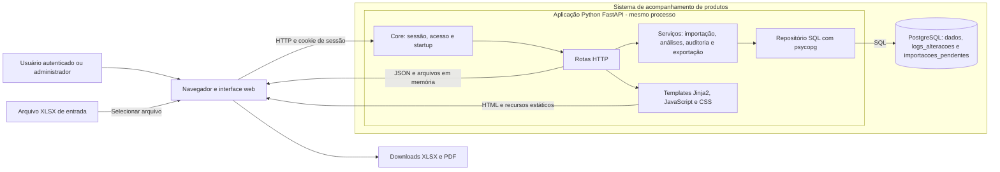
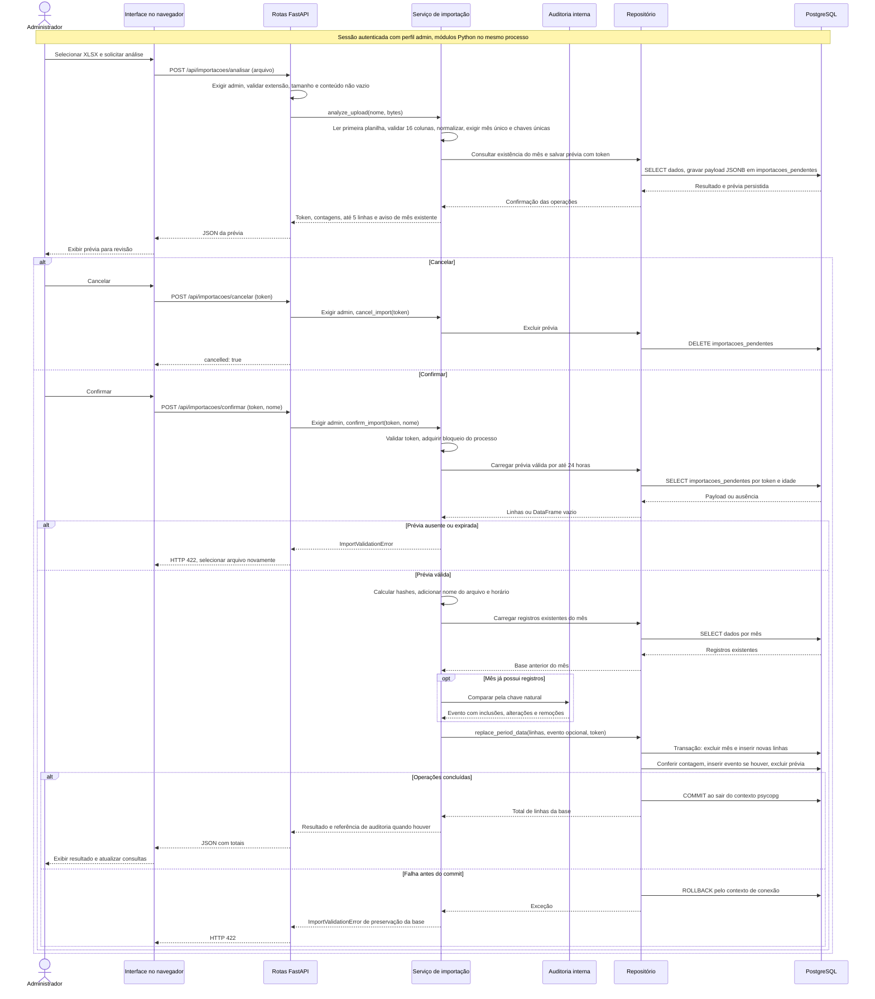

# Acompanhamento de Produtos

Aplicação web de acompanhamento de metas e produção por produto, período e unidade (PA). Importa planilhas XLSX, permite revisar uma prévia antes da confirmação, apresenta indicadores e exporta relatórios. Este repositório descreve a implementação atual para estudo acadêmico; use somente dados sintéticos em demonstrações.

## Contexto, objetivo e escopo

O problema tratado é transformar uma base mensal de metas e produção em consultas comparáveis, com rastreabilidade da substituição de períodos. O sistema cobre importação, consultas gerenciais, estudo de evolução anual, exportação e auditoria. Não é um sistema de origem dos dados nem realiza backup automático do PostgreSQL.

**Nível da visão:** alto nível para a atividade Diagrams as Code, inspirado nas fronteiras de uma visão C4 de containers, com detalhamento das camadas internas. Os diagramas usam Mermaid nativo do GitHub; não se declara conformidade completa com C4. Container aqui significa unidade de execução, não imagem Docker.

**Limites:** pertencem ao sistema a aplicação Python, os recursos web e o armazenamento lógico no PostgreSQL. O navegador, a preparação das planilhas e a operação do servidor de banco são externos ao processo Python. O sistema recebe JWT, mas não emite tokens nem implementa cadastro de usuários. A origem e o contrato de emissão dos tokens não são verificáveis neste repositório; nenhum provedor externo específico é presumido.

**Atores:** sessão autenticada consulta indicadores e exporta acompanhamento; perfil `admin` também importa, consulta auditoria, exporta a base e limpa o armazenamento. O bypass de desenvolvimento cria uma sessão local com perfil configurável, sem conceder `admin` automaticamente.

Nesta documentação, **fato observado** é comportamento sustentado pelos arquivos citados; **interpretação arquitetural** é a classificação desses fatos em camadas e fronteiras; **lacuna** é decisão ou evidência ausente, não uma funcionalidade proposta como existente.

## Funcionalidades

- Upload XLSX de até 50 MB, validação, normalização, prévia e confirmação por token.
- Reimportação de mês por substituição transacional, com registro das diferenças no PostgreSQL.
- Consultas sintética e analítica, produtos gerais e sete produtos foco, desempenho por PA e projeção anual.
- Exportação Excel da base e do acompanhamento; PDF dos cartões por agência.
- Sessão autenticada por JWT; operações de importação, auditoria, limpeza e exportação da base exigem perfil `admin`.

## Tecnologias e arquitetura

Python 3.10 ou superior, FastAPI, Jinja2, JavaScript, pandas, openpyxl, psycopg 3, PostgreSQL, ReportLab, PyJWT e pytest. É um **monólito modular**: `app/` define HTTP e autenticação, `services/` contém os fluxos e cálculos, `repo/` concentra SQL, `views/` contém templates e recursos estáticos. A inicialização cria schema e tabelas no banco configurado; não há mecanismo de migração versionada.

```text
app.py -> app/launcher.py -> app/main.py -> app/core.py
app/routes/       HTTP e controle de acesso
services/         importação, análise, auditoria e exportação
repo/             configuração e operações PostgreSQL
views/            templates Jinja2, JavaScript, CSS e imagens
tests/            testes automatizados
docs/             arquitetura, regras e validação
```

Os fluxos principais são: planilha → análise → prévia pendente → confirmação → dados e auditoria; e navegador → sessão → API de acompanhamento → serviços analíticos → PostgreSQL → tabelas, gráficos ou arquivo para download. Veja [arquitetura](docs/arquitetura.md), [importação](docs/fluxo-importacao.md), [banco de dados](docs/banco-de-dados.md) e [regras de negócio](docs/regras-negocio.md).

### Responsabilidades e evidências do discovery

| Área | Responsabilidade observada | Evidência |
|---|---|---|
| Entrada e configuração | Iniciar Uvicorn, resolver host/porta, caminhos e variáveis | `app.py`, `app/launcher.py`, `app/config.py` |
| HTTP e acesso | Sessão assinada, validação JWT, startup e rotas com verificação de perfil | `app/core.py`, `app/auth.py`, `app/routes/` |
| Importação | Ler XLSX, validar/normalizar, criar prévia, confirmar ou cancelar | `services/importer.py` |
| Análises | Filtrar DataFrames, aplicar alocações e calcular metas, aderência e evolução | `services/analytics*.py` |
| Auditoria e exportação | Comparar reimportações, consultar eventos e gerar XLSX/PDF em memória | `services/audit.py`, `services/exporter*.py` |
| Persistência | SQL, conexão psycopg, criação inicial, dados, prévias e logs | `repo/database.py`, `repo/database_*.py` |
| Frontend | Jinja2 monta HTML; JavaScript consulta a API, filtra, pontua e desenha gráficos; CSS apresenta | `views/templates/`, `views/src/app.js`, `views/src/modules/`, `views/css/` |
| Verificação e dependências | Testes simulados; dependências runtime equivalentes nos dois manifestos, pytest no extra `dev` | `tests/`, `requirements.txt`, `pyproject.toml` |

### Diagrama estrutural



O processo FastAPI serve a interface e a API. As caixas internas são módulos do mesmo monólito, sem servidores independentes. PostgreSQL é a unidade de armazenamento separada, incluída na fronteira lógica do sistema; o desenho não define sua localização de deploy. Templates são renderizados no servidor; JavaScript e CSS são enviados ao navegador. As integrações observadas são HTTP com o navegador, SQL com PostgreSQL, leitura XLSX e downloads XLSX/PDF. Não foi identificada chamada a API externa de negócio, fila ou modelo de IA em runtime.

### Diagrama comportamental: importação e confirmação



A análise já persiste a prévia, mas não substitui a base confirmada. A confirmação substitui **todo o mês**, não faz merge incremental. Exclusão, inserção, contagem, evento opcional e consumo da prévia pertencem à mesma transação. A primeira importação não gera evento de diferenças; a reimportação gera, mesmo sem diferenças. Consulta da prévia, leitura da base anterior e cálculo da auditoria antecedem essa transação. O bloqueio coordena apenas um processo. Os participantes são responsabilidades internas, e não serviços distribuídos. Erros de análise (400/413/422) e detalhes da expiração estão em [fluxo de importação](docs/fluxo-importacao.md).

### Decisões da documentação

- Classificar como monólito modular pela instância compartilhada de `app.core.app` e pelas chamadas Python diretas. A justificativa histórica de escolha da arquitetura não está registrada.
- Usar `flowchart` e `sequenceDiagram` em vez de extensões C4, mantendo os dois diagramas incorporados ao README.
- Representar prévias e auditoria no PostgreSQL, sem inventar diretório temporário, serviço de arquivos ou fila.
- Manter regras de cálculo e funcionamento existentes; registrar limitações como lacunas para evolução, sem implementar alterações nesta atividade.

## Persistência e regras

O schema padrão `performance_produtos` contém `dados`, `logs_alteracoes` e `importacoes_pendentes`. A chave natural dos dados é central, cooperativa, PA, identificador do produto e mês. Os indicadores usam campos mensais ou a última posição anual conforme a base de cálculo; produtos de saldo têm tratamento próprio. As alocações e o rateio de Venda Nova PA são aplicados nas consultas, sem alterar o dado importado. O [modelo](docs/banco-de-dados.md) e as [fórmulas](docs/regras-negocio.md) detalham limites e exceções.

## Segurança e controle de acesso

`POST /login` valida JWT com segredo HS256 em desenvolvimento ou chave pública configurada em produção e grava a identidade em cookie de sessão. O bypass local requer **ambos** `ENVIRONMENT=development` e `--development`. As rotas `/api/*` exigem sessão; a checagem de `admin` existe nas rotas de importação, limpeza, logs e exportação da base. Outras exportações e análises aceitam qualquer sessão autenticada. Mantenha o servidor restrito a `127.0.0.1` em desenvolvimento e substitua os segredos de exemplo antes de testar JWT.

## Como executar localmente (Windows PowerShell)

1. Instale Python 3.10+ e PostgreSQL local. Um ambiente virtual copiado de outro computador deve ser recriado; seus executáveis e caminhos podem não funcionar.
2. Na raiz do projeto, execute:

   ```powershell
   py -m venv .venv
   .\.venv\Scripts\Activate.ps1
   python -m pip install -r requirements.txt
   python -m pip install -e ".[dev]"
   ```

   Se o launcher `py` não estiver disponível, use o caminho do Python instalado no primeiro comando. O segundo comando de instalação instala o projeto em modo editável e inclui as dependências de desenvolvimento do extra `dev` de `pyproject.toml`, entre elas pytest.
3. Crie banco e usuário locais. Exemplo no `psql` com um usuário administrador local:

   ```sql
   CREATE DATABASE acompanhamento_produtos;
   -- O usuário configurado precisa de CONNECT no banco e CREATE no banco
   -- para que o startup crie o schema e as três tabelas.
   ```

4. Copie [.env.example](.env.example) para `.config/.env` e ajuste **localmente** `PGUSER`, `PGPASSWORD` e demais valores. `.config/.env` tem prioridade sobre `.env` da raiz; variáveis de processo `PG*` têm prioridade sobre ambos. Se já houver `.config/.env`, confira que aponta para o banco local e não o sobrescreva sem necessidade. Também é aceito `.config` como arquivo INI com `[postgresql]`, `[storage]` e `[server]`, mas esse formato e o diretório `.config/` ocupam o mesmo caminho e não coexistem.
5. Mantenha `ENVIRONMENT=development` e o host `127.0.0.1`. Para ensaiar importação e auditoria com dados sintéticos, acrescente `ENVIRONMENT_PROFILE=admin` somente à configuração local: o exemplo não concede esse perfil. Execute:

   ```powershell
   python app.py --development
   ```

   A URL padrão é `http://127.0.0.1:8000`. A API documentada fica em `/api/docs` após login. O launcher pode abrir o navegador automaticamente; `_open_browser()` lê `ACOMPANHAMENTO_OPEN_BROWSER` apenas do ambiente do processo. Para impedir essa abertura no PowerShell, use `$env:ACOMPANHAMENTO_OPEN_BROWSER = "0"` antes de iniciar. O valor no dotenv, isoladamente, não controla essa função.

A flag `--development` é verificada em `app/core.py` nos argumentos do processo e habilita o bypass somente junto com `ENVIRONMENT=development`. A inicialização exige conexão PostgreSQL válida e permissão para criar schema/tabelas. A mensagem de endereço de rede do launcher não comprova acesso pela rede quando o bind está em loopback.

## Testes e validação

```powershell
python -m compileall -q app repo services utils tests
python -m pytest -q
```

A suíte usa armazenamento em memória e mocks; ela não comprova uma conexão PostgreSQL real. A [estratégia e os resultados de validação](docs/testes-e-validacao.md) separam isso da checagem manual de banco.

## Uso de IA Generativa e ajustes realizados

A IA foi usada no discovery estático, na organização da documentação, na proposta inicial dos diagramas Mermaid e na revisão de consistência. Os diagramas foram confrontados com rotas, serviços, SQL e frontend antes de sua inclusão. A aplicação não chama um modelo de IA durante a execução. A [declaração de uso](docs/uso-ia-generativa.md) detalha o método e seus limites.

**Erro real da geração nesta revisão:** a primeira proposta do diagrama de sequência tratou ponto e vírgula literal como pontuação comum nas mensagens. Por exemplo, gerou `R->>R: Exigir admin; validar extensão, tamanho e conteúdo não vazio`. Mermaid usa esse caractere como separador de instruções; a revisão substituiu por `R->>R: Exigir admin, validar extensão, tamanho e conteúdo não vazio`, aplicando o mesmo ajuste às demais mensagens. A [documentação oficial do Mermaid](https://mermaid.js.org/syntax/sequenceDiagram.html#entity-codes-to-escape-characters) exige escape para preservar ponto e vírgula em texto. Trata-se de erro de sintaxe da saída de IA, não de regra de negócio. Não foi executado um renderizador para medir o efeito visual da proposta anterior.

**Inferências arquiteturais anteriores — limite de evidência:** não há histórico de prompts, respostas iniciais ou revisões que permita comprovar e atribuir erros anteriores a uma geração específica de IA. A declaração anterior registra apoio de IA, mas isso não comprova a autoria de cada divergência. Nenhuma falsa inferência arquitetural histórica é inventada; os ajustes comprovados estão abaixo.

| Material de partida ou ambiguidade | Ajuste realizado | Evidência |
|---|---|---|
| README apresentava comando sem flag como alternativa no passo de desenvolvimento | Padronizado `python app.py --development`, explicando também `ENVIRONMENT=development` | `app/core.py::_development_login_bypass_enabled` |
| Diagramas estavam apenas em documentação complementar | Incorporados estrutura com fronteiras e sequência de importação no README | README anterior e `docs/` |
| Fluxo visual podia sugerir auditoria em toda importação | Sequência distingue primeira importação de reimportação e delimita a transação | `services/importer.py::confirm_import`, `repo/database_data.py::replace_period_data` |
| Interface diz "O log foi salvo localmente" e resposta usa `log_file` | Documentado como referência lógica a evento PostgreSQL, sem arquivo de log | `views/src/modules/03-import.js`, `services/importer.py`, `repo/database_logs.py` |
| Exemplo contém controle de navegador no dotenv | Explicitado que a abertura automática lê somente a variável do processo | `app/launcher.py::_open_browser` |
| Bypass podia ser confundido com acesso administrativo | Documentado que `ENVIRONMENT_PROFILE=admin` deve ser configurado localmente para importar | `app/routes/auth.py`, `app/core.py::_require_admin` |
| Diagrama JWT dizia apenas "validar assinatura, expiração e tipo" | Esclarecido que `exp` não é exigida e tipo é checado quando presente | `app/auth.py::verificar_token` |

As divergências da tabela são correções documentais comprovadas, sem atribuição histórica não verificável à IA. O erro de sintaxe relatado separadamente ocorreu nesta revisão. Código funcional, mensagens da interface, dependências e `.env.example` foram preservados.

## O que ainda precisaria ser documentado para implementação autônoma

O código permite descobrir o comportamento atual, mas não substitui os contratos e critérios necessários para reconstruí-lo sem escolher regras por conta própria.

| Lacuna ou decisão não definida | Informação necessária para um agente | Situação observada |
|---|---|---|
| Contrato de entidades e planilha | Dicionário completo com significado, unidades, domínios, obrigatoriedade e exemplos sintéticos | Colunas, chave natural e conversões existem; sem contrato semântico completo |
| Schema e evolução | Versões suportadas do PostgreSQL, migrações e compatibilidade de payloads | DDL inicial em Python e `schema_version` do evento, sem migrações versionadas |
| Invariantes de negócio | Critérios para negativos, não finitos, metas ausentes, rateio, produtos e denominadores 18/7 | Regras implementadas e parcialmente descritas, sem justificativas e aceite completo |
| Identidade e autorização | Emissor e contrato JWT, claims obrigatórias, algoritmos por ambiente e matriz de permissões | Validação local e checagem `admin`; sem emissão e sem restrição de consultas por PA do usuário |
| Prévia e concorrência | Propriedade do token, isolamento entre administradores, repetição e conflito entre workers | Token sem vínculo à sessão; validade de 24 horas; bloqueio somente no processo |
| Precisão financeira | Escala, arredondamento, tolerâncias e valores aceitos formalmente | `float64`/`DOUBLE PRECISION`, tolerância `1e-9` na auditoria |
| Contratos HTTP e frontend | Schemas de requisição/resposta, erros por cenário, defaults e pontuação JavaScript | OpenAPI disponível após login, mas várias respostas são `dict` e regras de combo ficam no navegador |
| Auditoria e observabilidade | Identidade do operador, retenção, eventos necessários e monitoramento | Evento de diferenças não registra operador; sem trilha completa de login, primeira importação ou limpeza |
| Deploy e recuperação | Topologia, TLS/proxy, segredos, privilégios, backup e restauração | Configuração de host/prefixo existe; procedimentos e objetivos de recuperação não definidos |
| Requisitos e aceite | Volume, memória, tempo de resposta, disponibilidade e cenários de exceção | Testes simulados; sem teste PostgreSQL real, concorrência ou medição de capacidade |

Esses pontos são lacunas de especificação e operação. Não autorizam um agente a mudar as regras existentes. Detalhes em [regras](docs/regras-negocio.md), [riscos](docs/riscos-e-limitacoes.md) e [testes](docs/testes-e-validacao.md).

## Versionamento, entrega e documentação complementar

O repositório público da entrega é [performance_produtos_academico](https://github.com/joaonicholasfigueiredo/performance_produtos_academico).

O README reúne descrição, decisões, ajustes de IA e os dois blocos Mermaid renderizáveis pelo GitHub. A renderização visual no GitHub ainda precisa ser conferida após a publicação; a presença dos blocos no arquivo não comprova uma renderização remota já executada.

Documentação complementar: [arquitetura](docs/arquitetura.md), [banco de dados](docs/banco-de-dados.md), [importação](docs/fluxo-importacao.md), [proteção das informações](docs/protecao-informacoes.md), [regras de negócio](docs/regras-negocio.md), [riscos e limitações](docs/riscos-e-limitacoes.md), [testes e validação](docs/testes-e-validacao.md) e [uso de IA generativa](docs/uso-ia-generativa.md).

O histórico Git existente mistura mensagens em texto livre e prefixos como `FEAT`/`FIX`; não se afirma adesão integral a Conventional Commits. A recomendação para evoluções é adotar mensagens consistentes sem reescrever o histórico. Há mistura de CRLF/LF no checkout; nenhuma normalização em massa foi feita.

Limites atuais incluem ausência de migrações e backup automatizado, cálculos monetários em `float`, testes sem PostgreSQL real e risco de dados sensíveis em exportações. Consulte [riscos e limitações](docs/riscos-e-limitacoes.md) e [proteção das informações](docs/protecao-informacoes.md).

Este material foi preparado para atividade de pós-graduação. Autor e instituição podem ser informados no contexto da entrega acadêmica, sem incluir identificadores internos do ambiente de origem.
