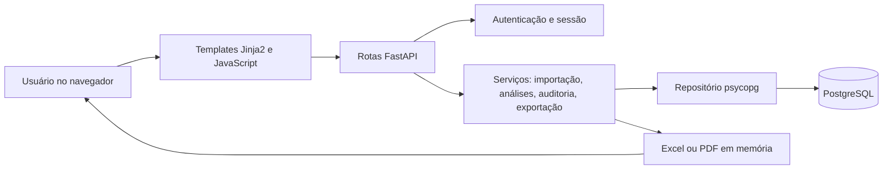
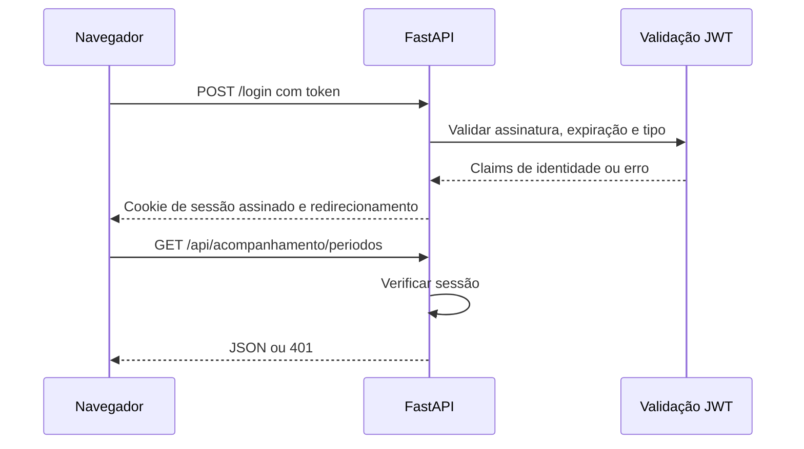
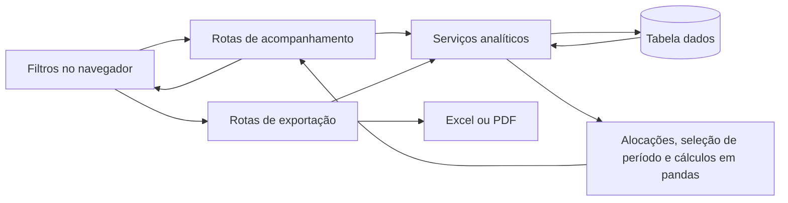

# Arquitetura da aplicação

## Organização

O projeto é um monólito modular em camadas. `app.py` chama `app.launcher.main`, que monta a aplicação definida em `app.core` via `app.main`. O mesmo processo serve templates Jinja2, arquivos estáticos e endpoints JSON. Não há microsserviços nem fila externa. O startup chama `repo.database.initialize_database()` e depende de PostgreSQL acessível.

`app/config.py` resolve diretórios, colunas da planilha e variáveis de configuração. `app/core.py` registra middlewares, sessão, tratamento do prefixo de proxy e startup. `app/routes/` separa `auth`, `admin`, `imports`, `analytics` e `exports`. `services/analytics_common.py` compartilha filtros e alocações; os módulos `analytics_production`, `analytics_summary`, `analytics_agencies` e `analytics_evolution` implementam visões distintas. `services/exporter_*` gera os arquivos sem gravação local. `repo/database_core.py` lê a configuração e cria as tabelas; `database_data`, `database_pending` e `database_logs` executam SQL específico. As fachadas `app/main.py`, `repo/database.py`, `services/analytics.py` e `services/exporter.py` mantêm imports públicos estáveis.

## Rotas e controle de acesso

| Área | Endpoints | Requisito |
|---|---|---|
| Autenticação | `/login`, `/logout`, `/api/usuario` | Login público; usuário requer sessão |
| Administração | `/`, `/api/base/status`, `/api/base/limpar`, `/api/logs` | Página requer sessão; APIs administrativas exigem `admin` |
| Importação | `/api/importacoes/analisar`, `/confirmar`, `/cancelar` | `admin` |
| Acompanhamento | `/api/acompanhamento/periodos`, `/producao-acumulada`, `/producao-analitica`, `/resumo-unidades`, `/desempenho-produtos-foco`, `/agencias`, `/estudo-evolucao` | Sessão |
| Exportação | `/api/exportacoes/base`, `/acompanhamento`, `/acompanhamento-agencias` | Base: `admin`; demais: sessão |

Em desenvolvimento existe um bypass explícito: `ENVIRONMENT=development` junto com `--development` permite `GET /login` para criar sessão local. Em produção, a validação JWT usa `PUBLIC_KEY_PATH`; nos demais ambientes usa `SECRET_KEY`. O cookie é assinado por `SessionMiddleware`, com idade padrão de oito horas. O perfil `admin` é checado nas rotas citadas, e não é inferido do nome do usuário.

## Consulta e apresentação

`views/templates/index.html` reúne os parciais. `views/src/app.js` carrega módulos JavaScript que consultam a API e atualizam tabelas, gráficos e filtros; `views/css/` define a apresentação. O serviço lê os registros, aplica alocações gerenciais em memória e calcula os resultados. Há custo de memória proporcional aos dados carregados, pois as consultas analíticas usam DataFrames.

## Fronteiras operacionais

O banco é a única persistência operacional do aplicativo: dados importados, prévias e eventos de auditoria. Não existe migração versionada, fila de jobs, cache distribuído ou integração de IA em runtime. O projeto lê JWT recebido do ambiente externo, mas não emite tokens de identidade. Consulte [importação](fluxo-importacao.md), [modelo de dados](banco-de-dados.md) e [riscos](riscos-e-limitacoes.md).
