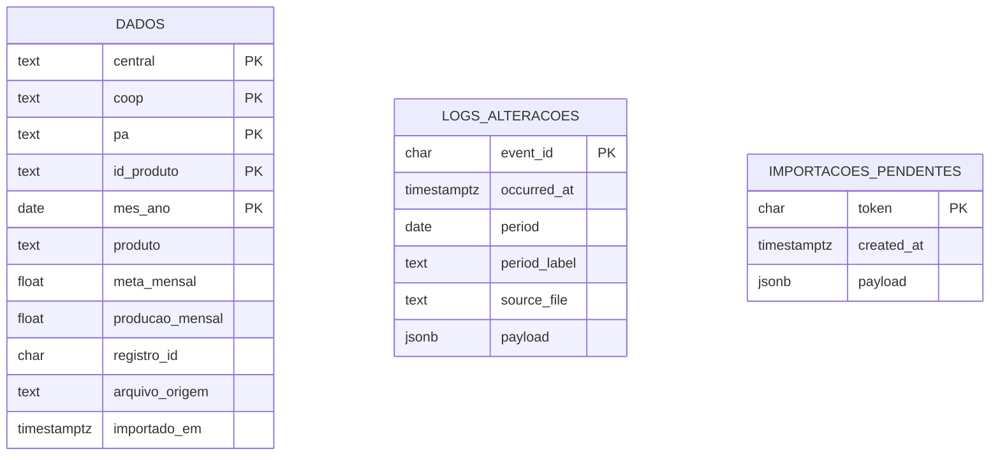

# Persistência PostgreSQL

`repo/database_core.py` lê `PGHOST`, `PGPORT`, `PGDATABASE`, `PGUSER` e `PGPASSWORD` do processo, depois de `.config/.env` ou `.env`, ou de `.config` em formato INI. O schema padrão é `performance_produtos`. `initialize_database()` é chamado no startup e usa `CREATE SCHEMA/TABLE/INDEX IF NOT EXISTS`. O banco deve existir previamente. O usuário precisa conectar ao banco e criar objetos nele; alterações posteriores de estrutura não são migradas automaticamente.



O diagrama representa três tabelas no mesmo schema; **não há chave estrangeira declarada** entre elas. `period` nos logs e o mês dentro dos payloads permitem correlação lógica, mas não impõem integridade referencial.

| Tabela | Finalidade e chave | Campos principais | Índices e operações |
|---|---|---|---|
| `dados` | Base importada; PK composta `central, coop, pa, id_produto, mes_ano` | `produto`; pares meta/produção `mensal`, `trimestral`, `semestral`, `anual`, `no_periodo`; `registro_id` SHA-256; `arquivo_origem`; `importado_em` | PK e índice por `mes_ano`; leitura analítica, consulta de período e substituição transacional do mês |
| `logs_alteracoes` | Eventos de reimportação; PK `event_id` | `occurred_at`, `period`, `period_label`, `source_file`, `payload` JSONB com resumo e diferenças | Índice em `(period, occurred_at DESC)`; inserção idempotente por `event_id`, leitura por data decrescente |
| `importacoes_pendentes` | Prévia antes da confirmação; PK `token` | `created_at`, `payload` JSONB com linhas normalizadas | Upsert por token; leitura apenas de prévias com menos de 24 horas; remoção após confirmar/cancelar |

Todos os campos da PK e os campos principais listados no SQL são `NOT NULL` onde declarado. As métricas são `DOUBLE PRECISION` com padrão zero; isso implica arredondamento binário. `payload` é JSONB. Não há FK, `CHECK` de valor financeiro ou política de retenção automática para logs e dados confirmados. A limpeza de prévias vencidas ocorre na próxima gravação de prévia, não por tarefa agendada.

O método `replace_period_data()` faz `DELETE WHERE mes_ano = ...` seguido de `INSERT` no mesmo contexto de conexão, confere a contagem de linhas e inclui auditoria e remoção da prévia antes do commit. `drop_storage()` usa `DROP SCHEMA ... CASCADE` na função administrativa de limpeza; ela também elimina logs e prévias. Use banco local isolado para validar a aplicação e não execute a limpeza sobre uma base compartilhada.

Para conferir a conexão sem modificar dados, execute uma consulta com o usuário local configurado:

```sql
SELECT current_database(), current_user, 1;
```

Depois do startup, é possível conferir a presença das tabelas no schema configurado. Não registre em documentação a string de conexão completa nem o conteúdo de `dados` ou dos payloads de auditoria.
