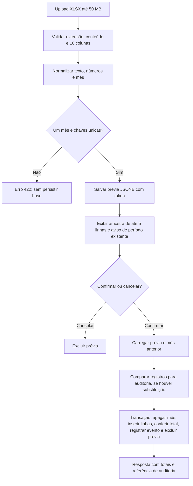

# Fluxo de importação XLSX

O fluxo está em `app/routes/imports.py`, `services/importer.py`, `services/audit.py` e `repo/database_*.py`. Apenas sessões com perfil `admin` podem executá-lo.

O [diagrama de sequência principal](../README.md#diagrama-comportamental-importação-e-confirmação) está incorporado no README para avaliação. O fluxograma abaixo resume a jornada; os passos seguintes detalham contratos e limites reais.

## Análise e prévia

`POST /api/importacoes/analisar` aceita somente nome `.xlsx`, arquivo não vazio e tamanho máximo de 50 MB. O pandas/openpyxl lê a primeira planilha. Os nomes das 16 colunas esperadas podem variar em acentos e separadores, mas colunas equivalentes duplicadas ou ausentes geram erro. Colunas extras são descartadas. Textos vazios viram `"0"`, números vazios viram `0.0`, e textos numéricos são convertidos com suporte a formatos comuns de vírgula, ponto, símbolo monetário e porcentagem. O mês pode vir como data, número serial Excel ou texto; é normalizado para o primeiro dia. O arquivo deve conter um único mês e não pode repetir a chave `CENTRAL + COOP + PA + ID_PRODUTO + MÊS/ANO`.

A análise consulta se o período já existe e grava todas as linhas normalizadas em `importacoes_pendentes` como JSONB, com token aleatório de 32 caracteres hexadecimais. A resposta traz contagens e até cinco linhas de prévia. A prévia vale 24 horas; a limpeza de prévias antigas ocorre quando uma nova é salva. Prévia expirada ou já consumida não pode ser confirmada.

O token não está vinculado ao usuário ou à sessão na tabela nem nas consultas. As rotas exigem `admin`, mas não verificam a propriedade da prévia entre administradores. A análise persiste o payload antes da confirmação; não existe arquivo XLSX temporário salvo pelo aplicativo.

## Confirmação, reimportação e falhas

`POST /api/importacoes/confirmar` exige token e nome do arquivo. Um bloqueio em memória serializa confirmações **dentro de um processo**. O serviço recupera a prévia, calcula SHA-256 por linha, adiciona nome do arquivo e horário, e carrega o mês existente. Se o mês já existe, `services/audit.py` compara os registros pela chave natural e identifica incluídos, alterados e removidos. A comparação inclui produto e campos numéricos; diferenças numéricas inferiores ou iguais a `1e-9` não são tratadas como alteração.

`repo/database_data.py` executa exclusão do mês, inserção, conferência da quantidade persistida, inserção do evento de auditoria e exclusão da prévia **na mesma transação**. Uma exceção antes do commit faz o contexto psycopg reverter essa transação. A substituição é por período inteiro, inclusive para linhas removidas do novo arquivo. A primeira importação não cria evento de diferenças; a reimportação cria evento em `logs_alteracoes`, mesmo quando a lista de mudanças está vazia. O nome do arquivo é metadado fornecido pelo usuário, sem upload permanente do XLSX.

A carga da prévia e a leitura do mês anterior usam conexões próprias e ocorrem antes da transação de substituição. O bloqueio local não garante isolamento desse conjunto entre workers. O evento não recebe a identidade do operador. O campo de resposta `log_file` é uma referência lógica ao PostgreSQL, não um caminho de arquivo; a mensagem da interface sobre log salvo "localmente" é imprecisa. Essa divergência foi registrada, sem alterar JavaScript ou regras funcionais.

`POST /api/importacoes/cancelar` elimina a prévia válida. Erros de formato retornam 400, excesso de tamanho 413, e validações de conteúdo ou indisponibilidade durante a análise retornam 422. Falhas na confirmação retornam mensagem genérica de preservação da base; a transação evita substituição parcial, mas não substitui backup. O bloqueio em memória não coordena múltiplos processos ou servidores.
